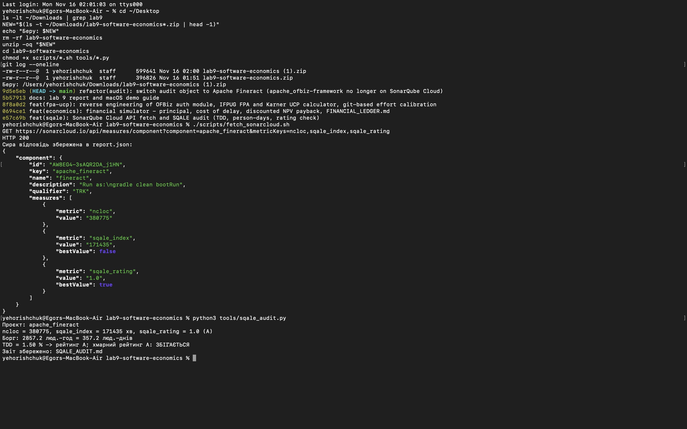
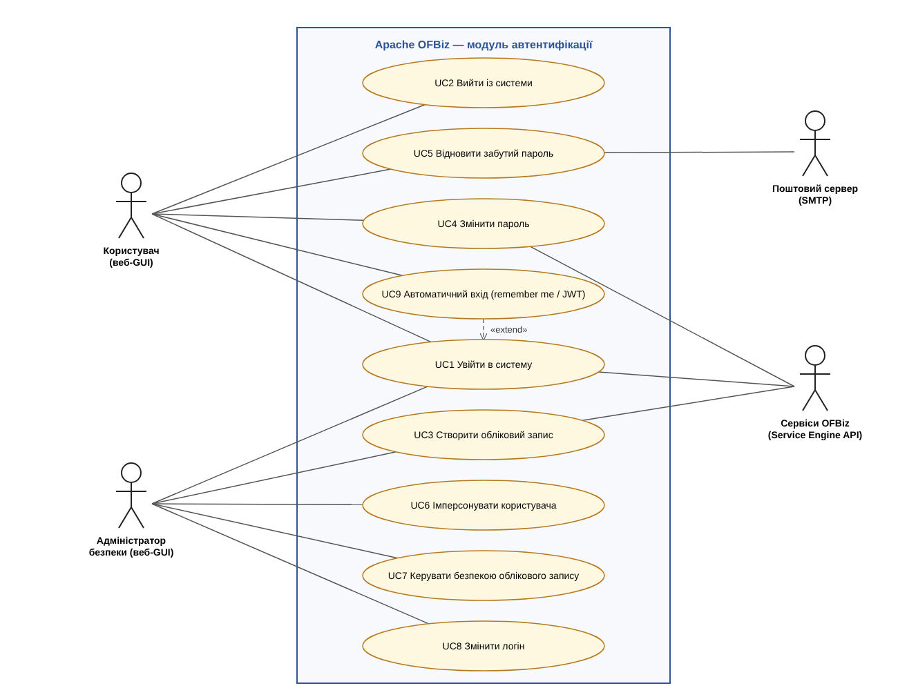

# Лабораторна робота №9. SQALE, фінансова капіталізація технічного боргу, FPA & UCP

> Project Hub-звіт. Відкривати в Obsidian з **коренем репозиторію як vault**: тоді вбудовування
> `![[SQALE_AUDIT.md]]` та `![[FINANCIAL_LEDGER.md]]` автоматично підставлять згенеровані файли.
> Поля `⟨…⟩` заповнюються після запуску скриптів (див. `docs/DEMO_LAB9.md`).

## Завдання 1. Forensic-аудит SQALE-моделі

### 1.1 Картка об'єкта аудиту
| Поле | Значення |
|---|---|
| Проєкт | **Apache OFBiz** — open-source ERP/CRM/e-commerce на Java (облік, замовлення, склад, виробництво, HR) |
| Репозиторій | https://github.com/apache/ofbiz-framework |
| SonarQube Cloud | https://sonarcloud.io/project/overview?id=apache_ofbiz-framework |
| project key / organization | `apache_ofbiz-framework` / `apache` |
| Масштаб (ncloc) | ⟨з report.json⟩ рядків (вимога ≥ 50 000) |

### 1.2 Протокол хмарного API-виклику
```
GET https://sonarcloud.io/api/measures/component?component=apache_ofbiz-framework&metricKeys=ncloc,sqale_index,sqale_rating
```
Виконується скриптом `scripts/fetch_sonarcloud.sh` (curl); повний лог із часом і HTTP-статусом — `data/api-call.log`.

Сира відповідь сервера (`report.json`):
```json
⟨вставити вміст report.json; ключі "ncloc", "sqale_index", "sqale_rating"⟩
```


### 1.3 Паспорт технічного боргу (SQALE Audit Ledger)
Розрахунок виконує `tools/sqale_audit.py`:
- борг, год = sqale_index / 60; борг, роб. днів = год / 8;
- час розробки з нуля = ncloc × 30 хв / 60 = ncloc × 0,5 год;
- TDD = борг, год / (ncloc × 0,5) × 100 %.

![[SQALE_AUDIT.md]]

### 1.4 Висновок аудитора
⟨1–3 речення: TDD = … % → рейтинг …; хмарний sqale_rating = …; збігається / не збігається;
наприклад: «борг ≈ N люд.-днів при TDD X % — система в зеленій зоні SQALE, борг не критичний відносно масштабу»⟩

## Завдання 2. Software Economics та Financial Quality Ledger

### 2.1 Вихідний код симулятора
Файл `tools/financial_ledger.py` (повний текст — у репозиторії; ключові функції):
```python
def principal(sqale_index, hourly_rate, overload):
    """Тіло боргу: вартість повного виправлення системи прямо зараз."""
    return (sqale_index / 60) * hourly_rate * overload

def cost_of_delay(ncloc, hourly_rate):
    """Щомісячні збитки бізнесу від бездіяльності (FAIL-стан)."""
    return (ncloc / LINES_PER_LOST_HOUR) * hourly_rate

def npv_schedule(cod, debt_principal, discount_rate, months=HORIZON_MONTHS):
    rows, cumulative_pv, payback_month = [], 0.0, None
    for t in range(1, months + 1):
        discount_factor = 1 / (1 + discount_rate) ** t
        discounted_cash_flow = cod * discount_factor
        cumulative_pv += discounted_cash_flow
        npv_t = cumulative_pv - debt_principal
        if npv_t > 0 and payback_month is None:
            payback_month = t
        rows.append({...})
    return rows, payback_month
```
- вхід: `report.json` (sqale_index, ncloc читаються динамічно) + змінні оточення `HOURLY_RATE`, `OVERLOAD_COEFF`, `DISCOUNT_RATE`;
- вихід: `FINANCIAL_LEDGER.md` у корені проєкту, код виходу 0 (PASS) / 1 (FAIL);
- юніт-тести з ручним перерахунком: `tests/test_financial_ledger.py` (5 тестів).

### 2.2 Консольний запуск
```bash
HOURLY_RATE=40 OVERLOAD_COEFF=1.3 DISCOUNT_RATE=0.01 python3 tools/financial_ledger.py
```


### 2.3 Згенерований артефакт FINANCIAL_LEDGER.md
![[FINANCIAL_LEDGER.md]]

### 2.4 Аналітичний висновок щодо Software Economics
Підставимо формули в умову окупності NPV > 0. Ставка `HOURLY_RATE` входить і в тіло боргу, і в Cost of Delay,
тому **скорочується: точка окупності від ставки не залежить**. Вона визначається лише відношенням боргу до масштабу:

- без дисконтування місяць окупності ≈ Тіло / CoD = (sqale_index/60 × 1,3) / (ncloc/100) ≈ 2,17 × sqale_index / ncloc;
- оскільки TDD = sqale_index / (30 × ncloc), це **≈ 65 × TDD** (TDD як частка): система з TDD 2 % окупає рефакторинг
  приблизно за 1,3 міс., з TDD 5 % (межа рейтингу A) — за ~3,3 міс.;
- з дисконтом 1 %/міс сума за 6 місяців = 5,80 × CoD, тож **PASS на горизонті 6 місяців можливий лише при TDD < ~8,9 %**
  (рейтинги A і нижня половина B). Для систем із рейтингом C і гірше разовий повний рефакторинг збитковий — потрібна поетапна стратегія.

Отже, великий ncloc сам по собі пришвидшує окупність (більше коду — більші щомісячні втрати від регресій), а накопичений
SQALE-індекс сповільнює її лінійно. Для OFBiz: ⟨Payback = N-й місяць, NPV₆ = $…, статус PASS/FAIL⟩.

## Завдання 3. Функціональне вимірювання розміру модуля (FPA & UCP)

### 3.1 Специфікація реверс-інжинірингу
Підмодуль: **автентифікація та контроль доступу OFBiz** (3 класи, 3 179 фізичних рядків, OFBiz trunk @ cf5a95ae84):

| Джерело | Артефакт |
|---|---|
| Сервісний шар | `LoginServices.java`: `userLogin`, `userImpersonate`, `createUserLogin`, `updatePassword`, `updateUserLoginId`, `updateUserLoginSecurity`, `createUserLoginPasswordHistory`, `checkNewPassword`, `checkPassword` |
| HTTP-шар | `LoginWorker.java`: `login`, `logout`, `impersonateLogin`, `depersonateLogin`, `checkLogin`, `extensionCheckLogin`, `isUserLoggedIn`, `autoLoginCheck`, `securedUserLoginByJWTCookie`, `getUserLoginSession`, `hasApplicationPermission`, `hasBasePermission` |
| Відновлення пароля | `LoginEvents.java`: `forgotPassword`, `showPasswordHint`, `emailPasswordRequest` |
| ORM-схема | `framework/security/entitydef/entitymodel.xml`: UserLogin (16 полів), UserLoginPasswordHistory, UserLoginHistory, UserLoginSession, SecurityGroup, SecurityGroupPermission, SecurityPermission, UserLoginSecurityGroup |
| Контракти | `framework/common/servicedef/services.xml` (IN/OUT-атрибути сервісів) |
| HTTP-маршрути | `common-controller.xml`: `login`, `logout`, `checkLogin`, `ajaxCheckLogin`, `impersonateLogin`, `depersonateLogin`, `forgotPassword`, `passwordChange` |

Повний перелік сигнатур із номерами рядків — аркуш **Sources** у `fpa-ucp/FPA_UCP_Calculator.xlsx`.

UML Use Case діаграма (`docs/usecase-auth.drawio`, редагується в draw.io):



### 3.2 FPA калькулятор (IFPUG Ledger)
| # | Елемент | Кат. | RET/FTR | DET | Складність | FP |
|---|---|---|---|---|---|---|
| 1 | UserLogin + UserLoginPasswordHistory | ILF | 2 | 18 | Low | 7 |
| 2 | UserLoginHistory | ILF | 1 | 7 | Low | 7 |
| 3 | Модель RBAC (SecurityGroup, UserLoginSecurityGroup, SecurityGroupPermission, SecurityPermission) | EIF | 4 | 11 | Low | 5 |
| 4 | UserLoginSession | EIF | 1 | 3 | Low | 5 |
| 5 | Party / Person / PartyGroup | EIF | 3 | 5 | Low | 5 |
| 6 | ProductStoreEmailSetting | EIF | 1 | 6 | Low | 5 |
| 7 | Вхід (userLogin, login) | EI | 2 | 5 | Average | 4 |
| 8 | Імперсонація (userImpersonate) | EI | 3 | 5 | High | 6 |
| 9 | Завершення імперсонації (depersonateLogin) | EI | 2 | 2 | Low | 3 |
| 10 | Створення облікового запису (createUserLogin) | EI | 2 | 10 | Average | 4 |
| 11 | Зміна пароля (updatePassword) | EI | 2 | 7 | Average | 4 |
| 12 | Зміна логіна (updateUserLoginId) | EI | 1 | 2 | Low | 3 |
| 13 | Керування безпекою (updateUserLoginSecurity) | EI | 2 | 8 | Average | 4 |
| 14 | Вихід (logout) | EI | 1 | 2 | Low | 3 |
| 15 | Відновлення пароля e-mail (emailPasswordRequest) | EO | 3 | 6 | Average | 5 |
| 16 | Підказка пароля (showPasswordHint) | EQ | 1 | 2 | Low | 3 |
| 17 | Перевірка входу (checkLogin) | EQ | 1 | 3 | Low | 3 |
| 18 | Збережена сесія (getUserLoginSession) | EQ | 1 | 3 | Low | 3 |
| 19 | Перевірка доступу (hasApplicationPermission) | EQ | 1 | 3 | Low | 3 |
| | **UFP = FP (VAF = 1,00)** | | | | | **82** |

Підсумок за категоріями: ILF — 2 елементи, 14 FP; EIF — 4, 20 FP; EI — 8, 31 FP; EO — 1, 5 FP; EQ — 4, 12 FP.
Складність і вага рахуються формулами за матрицями IFPUG у таблиці (аркуш **FPA (IFPUG)**).

### 3.3 UCP матриця Карнера
| Актор | Тип | Вага |
|---|---|---|
| Користувач через веб-GUI | Complex | 3 |
| Адміністратор безпеки через веб-GUI | Complex | 3 |
| Поштовий сервер (SMTP) | Average | 2 |
| Сервіси OFBiz (Service Engine API) | Simple | 1 |
| **UAW** | | **9** |

| Use Case | Транзакцій | Вага |
|---|---|---|
| UC1 Увійти в систему | 9 | 15 |
| UC2 Вийти із системи | 3 | 5 |
| UC3 Створити обліковий запис | 7 | 10 |
| UC4 Змінити пароль | 6 | 10 |
| UC5 Відновити забутий пароль | 6 | 10 |
| UC6 Імперсонувати користувача | 6 | 10 |
| UC7 Керувати безпекою облікового запису | 3 | 5 |
| UC8 Змінити логін | 5 | 10 |
| UC9 Автоматичний вхід (remember me / JWT) | 4 | 10 |
| **UUCW** | | **85** |

UUCP = UAW + UUCW = 9 + 85 = **94**; TCF = ECF = 1,0 → **UCP = 94 × 1,0 × 1,0 = 94**.
Розкладка транзакцій кожного прецедента на кроки коду — аркуш **UCP (Karner)**.

### 3.4 Зворотне калібрування (Productivity Factor)
Трудовитрати відновлено з історії Git (`tools/git_effort.py`, `git log --follow` по трьох класах, 2006–2026):
коміти одного автора з інтервалом < 2 год — одна робоча сесія, +2 год на початок кожної сесії.

| Показник | Значення |
|---|---|
| Комітів / авторів | 312 / 30 |
| Реальні трудовитрати | **557,0 люд.-год** (деталізація: `data/git-effort-ofbiz-auth.md`) |
| Розмір | 94 UCP · 82 FP |
| **PF = 557,0 / 94** | **≈ 5,93 люд.-год / UCP** (≈ 6,79 люд.-год / FP) |

**Висновок Lead Engineer.** Отриманий PF перетворює функціональний розмір запиту на зміни на годинник і бюджет ще до
написання коду: аналітик описує Change Request як прецеденти (кількість транзакцій → вага 5/10/15) і акторів, рахує UCP,
множить на PF і ставку. Приклад: новий складний прецедент «двофакторна автентифікація» (15 UCP) → 15 × 5,93 ≈ 89 люд.-год
→ 89 × $40 × 1,3 ≈ **$4 620**. Оцінка спирається на історичну продуктивність саме цієї команди і цього модуля, тож вона
об'єктивніша за експертне «на око» і дає підставу для фіксованої ціни або резерву ризику.

Обмеження калібрування: евристика git-hours враховує лише час між комітами (без аналізу, рев'ю, тестування поза Git), а
коміти SVN-епохи часто робили комітери, які застосовували чужі патчі. Тому PF ≈ 5,9 — нижня межа; промислове
значення Карнера — 20 люд.-год / UCP. Для договірних оцінок варто додати коефіцієнт запасу 1,5–2 або перекалібрувати PF
за даними трекера задач (Jira OFBIZ).

## Лог валідації ШІ-Техліда
⟨Протокол згідно з інструкцією викладача + чесна декларація використання ШІ відповідно до Регламенту.⟩
