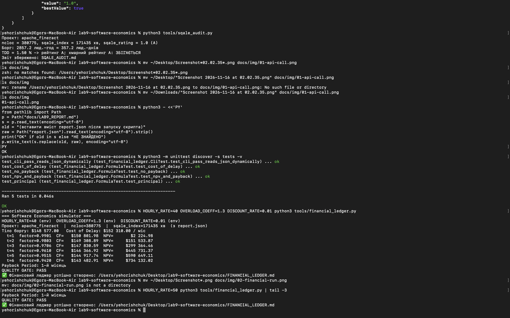
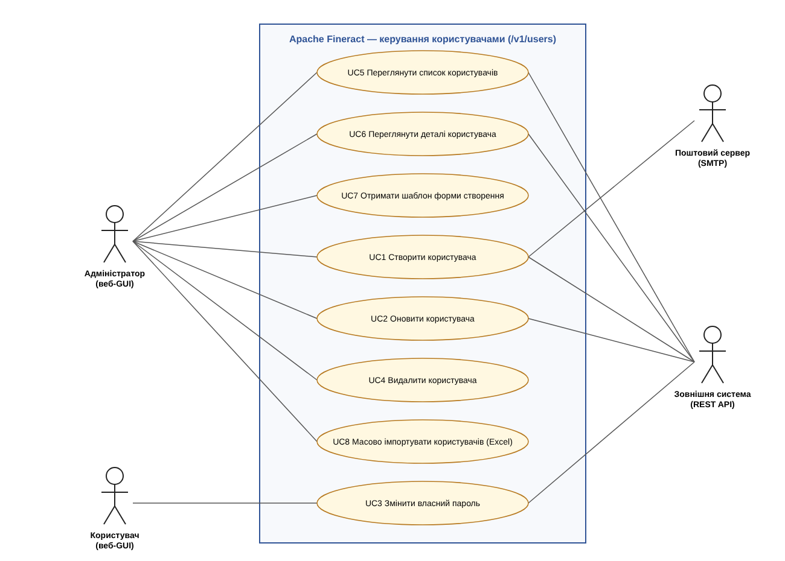
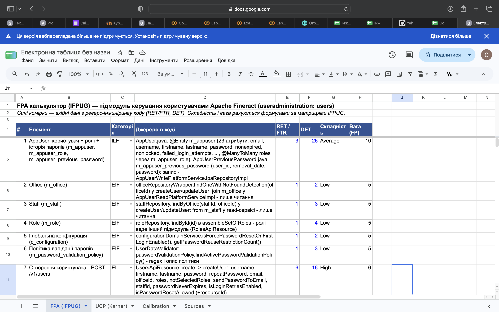
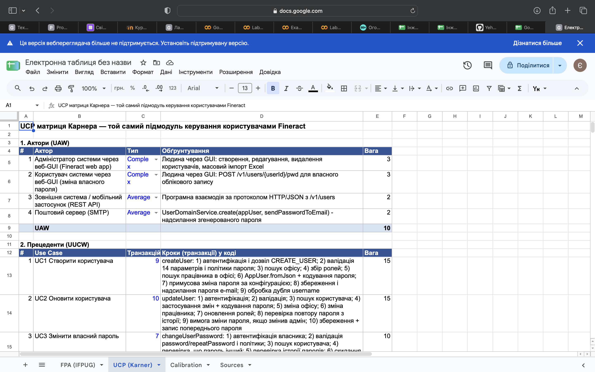

# Лабораторна робота №9. SQALE, фінансова капіталізація технічного боргу, FPA & UCP

> Project Hub-звіт. Відкривати в Obsidian з **коренем репозиторію як vault**: тоді вбудовування
> `![[SQALE_AUDIT.md]]` та `![[FINANCIAL_LEDGER.md]]` автоматично підставлять згенеровані файли.
> Числа нижче — зі знімка SonarQube Cloud від 16.11.2026; при повторному запуску скриптів вони можуть трохи змінитися.

## Завдання 1. Forensic-аудит SQALE-моделі

### 1.1 Картка об'єкта аудиту
| Поле | Значення |
|---|---|
| Проєкт | **Apache Fineract** — open-source core banking платформа (клієнти, кредити, депозити, бухоблік) для фінансових установ і мікрофінансування |
| Репозиторій | https://github.com/apache/fineract |
| SonarQube Cloud | https://sonarcloud.io/project/overview?id=apache_fineract |
| project key / organization | `apache_fineract` / `apache` |
| Масштаб (ncloc) | **380 775** рядків (вимога ≥ 50 000 ✅) |

Як обрано: запит `api/components/search_projects?organization=apache&filter=ncloc > 50000 and languages = java`
повернув 30 Java-проєктів Apache; Fineract обрано як бізнес-застосунок із чітким модулем RBAC для Завдання 3.

### 1.2 Протокол хмарного API-виклику
```
GET https://sonarcloud.io/api/measures/component?component=apache_fineract&metricKeys=ncloc,sqale_index,sqale_rating
HTTP 200
```
Виконується скриптом `scripts/fetch_sonarcloud.sh` (curl); повний лог із часом і статусом — `data/api-call.log`.

Сира відповідь сервера (`report.json`):
```json
{"component":{"id":"AW8EG4-3sAQR2DA_j1HN","key":"apache_fineract","name":"fineract","description":"Run as:\ngradle clean bootRun","qualifier":"TRK","measures":[{"metric":"ncloc","value":"380775"},{"metric":"sqale_index","value":"171435","bestValue":false},{"metric":"sqale_rating","value":"1.0","bestValue":true}]}}
```


### 1.3 Паспорт технічного боргу (SQALE Audit Ledger)
Розрахунок — `tools/sqale_audit.py`:
- борг = 171 435 хв / 60 = **2 857,2 люд.-год**; / 8 = **357,2 робочих днів**;
- час розробки з нуля = 380 775 × 30 хв / 60 = **190 387,5 год**;
- TDD = 2 857,2 / 190 387,5 × 100 % = **1,50 %**.

| Масштаб (ncloc) | Обсяг боргу (люд.-год / роб. днів) | TDD (%) | Рейтинг за TDD | Хмарний рейтинг (sqale_rating) |
|---|---|---|---|---|
| 380 775 | 2 857,2 / 357,2 | 1,50 | A | 1.0 = A ✅ збігається |

Згенерований файл:

![[SQALE_AUDIT.md]]

### 1.4 Висновок аудитора
Технічний борг Fineract — 357 інженерних днів, що для системи з 380 тис. рядків дає щільність лише 1,5 %: у 3,3 раза
нижче межі рейтингу A (5 %). Незалежний розрахунок TDD за формулою SQALE підтверджує хмарний рейтинг A.
Абсолютний обсяг боргу значний (≈ 1,5 люд.-року), але відносно масштабу система добре супроводжувана.

## Завдання 2. Software Economics та Financial Quality Ledger

### 2.1 Вихідний код симулятора
Файл `tools/financial_ledger.py` (повний текст — у репозиторії; ключові функції):
```python
def principal(sqale_index, hourly_rate, overload):
    """Тіло боргу: вартість повного виправлення системи прямо зараз."""
    return (sqale_index / 60) * hourly_rate * overload

def cost_of_delay(ncloc, hourly_rate):
    """Щомісячні збитки бізнесу від бездіяльності (FAIL-стан)."""
    return (ncloc / LINES_PER_LOST_HOUR) * hourly_rate

def npv_schedule(cod, debt_principal, discount_rate, months=HORIZON_MONTHS):
    rows, cumulative_pv, payback_month = [], 0.0, None
    for t in range(1, months + 1):
        discount_factor = 1 / (1 + discount_rate) ** t
        discounted_cash_flow = cod * discount_factor
        cumulative_pv += discounted_cash_flow
        npv_t = cumulative_pv - debt_principal
        if npv_t > 0 and payback_month is None:
            payback_month = t
        rows.append({...})
    return rows, payback_month
```
- вхід: `report.json` (sqale_index, ncloc читаються динамічно) + змінні оточення `HOURLY_RATE`, `OVERLOAD_COEFF`, `DISCOUNT_RATE`;
- вихід: `FINANCIAL_LEDGER.md` у корені проєкту, код виходу 0 (PASS) / 1 (FAIL);
- юніт-тести з ручним перерахунком: `tests/test_financial_ledger.py` (5 тестів).

### 2.2 Консольний запуск
```bash
HOURLY_RATE=40 OVERLOAD_COEFF=1.3 DISCOUNT_RATE=0.01 python3 tools/financial_ledger.py
```


### 2.3 Згенерований артефакт FINANCIAL_LEDGER.md
![[FINANCIAL_LEDGER.md]]

Ключові значення (HOURLY_RATE = $40, OVERLOAD_COEFF = 1,3, DISCOUNT_RATE = 0,01):

| Місяць | Коеф. дисконтування | Дисконтований прибуток | Кумулятивний NPV |
|---|---|---|---|
| 1 | 0,9901 | $150 801.98 | **$2 224.98** ✅ |
| 2 | 0,9803 | $149 308.89 | $151 533.87 |
| 3 | 0,9706 | $147 830.59 | $299 364.46 |
| 4 | 0,9610 | $146 366.92 | $445 731.37 |
| 5 | 0,9515 | $144 917.74 | $590 649.11 |
| 6 | 0,9420 | $143 482.91 | $734 132.02 |

Тіло боргу = (171 435 / 60) × 40 × 1,3 = **$148 577.00**; Cost of Delay = (380 775 / 100) × 40 = **$152 310.00 / міс**.
Payback Period — **1-й місяць**; **Quality Gate: PASS**.

### 2.4 Аналітичний висновок щодо Software Economics
Підставимо формули в умову окупності NPV > 0. Ставка `HOURLY_RATE` входить і в тіло боргу, і в Cost of Delay,
тому **скорочується: точка окупності від ставки не залежить** (перевіряється запуском з `HOURLY_RATE=50`). Вона визначається
лише відношенням боргу до масштабу:

- без дисконтування місяць окупності ≈ Тіло / CoD = (sqale_index/60 × 1,3) / (ncloc/100) ≈ 2,17 × sqale_index / ncloc;
- оскільки TDD = sqale_index / (30 × ncloc), це **≈ 65 × TDD** (TDD як частка): для Fineract 65 × 0,015 ≈ 0,98 міс — окупність
  настає вже в першому місяці, що й показав симулятор;
- з дисконтом 1 %/міс сума за 6 місяців = 5,80 × CoD, тож **PASS на горизонті 6 місяців можливий лише при TDD < ~8,9 %**
  (рейтинги A і нижня половина B). Для систем із рейтингом C і гірше разовий повний рефакторинг збитковий — потрібна
  поетапна стратегія.

Отже, великий ncloc сам по собі пришвидшує окупність (більше коду — більші щомісячні втрати від регресій), а накопичений
SQALE-індекс лінійно її сповільнює. Fineract з TDD 1,5 % — приклад системи, де інвестиція в рефакторинг повертається
майже одразу: NPV за 6 місяців у 4,9 раза перевищує вартість рефакторингу.

## Завдання 3. Функціональне вимірювання розміру підмодуля (FPA & UCP)

### 3.1 Специфікація реверс-інжинірингу
Підмодуль: **керування користувачами Fineract** (пакет `org.apache.fineract.useradministration`, 5 класів,
Apache Fineract develop @ b4dd31db4):

| Джерело | Артефакт |
|---|---|
| REST-контролер | `UsersApiResource` — `@Path("/v1/users")`: `GET /`, `GET /{userId}`, `GET /template`, `POST /`, `PUT /{userId}`, `POST /{userId}/pwd`, `DELETE /{userId}`, `GET /downloadtemplate`, `POST /uploadtemplate` |
| Сервіс запису | `AppUserWritePlatformServiceJpaRepositoryImpl`: `createUser(JsonCommand)`, `updateUser(Long, JsonCommand)`, `changeUserPassword(Long, JsonCommand)`, `deleteUser(Long)` |
| Сервіс читання | `AppUserReadPlatformServiceImpl`: `retrieveAllUsers()`, `retrieveUser(Long)`, `retrieveNewUserDetails()`, `isUsernameExist(String)` |
| JPA-сутності (ORM) | `AppUser` — `@Table(name = "m_appuser")`, 23 атрибути, `@ManyToMany roles` (`m_appuser_role`), `@ManyToOne office`, `staff`; `AppUserPreviousPassword` — `m_appuser_previous_password` |
| Довідкові дані (лише читання) | `m_office`, `m_staff`, `m_role`, глобальна конфігурація (`isForcePasswordResetOnFirstLoginEnabled`, `getPasswordReuseRestrictionCount`), `m_password_validation_policy` |
| Контракт параметрів | `UserDataValidator`: `CREATE/UPDATE_SUPPORTED_PARAMETERS` (14), `CHANGE_PASSWORD_SUPPORTED_PARAMETERS` (2) |

Повний перелік сигнатур із номерами рядків — аркуш **Sources** у `fpa-ucp/FPA_UCP_Calculator.xlsx`.

UML Use Case діаграма (`docs/usecase-users.drawio`, редагується в draw.io):



### 3.2 FPA калькулятор (IFPUG Ledger)
| # | Елемент | Кат. | RET/FTR | DET | Складність | FP |
|---|---|---|---|---|---|---|
| 1 | AppUser + ролі + історія паролів (m_appuser, m_appuser_role, m_appuser_previous_password) | ILF | 3 | 26 | Average | 10 |
| 2 | Office (m_office) | EIF | 1 | 2 | Low | 5 |
| 3 | Staff (m_staff) | EIF | 1 | 3 | Low | 5 |
| 4 | Role (m_role) | EIF | 1 | 4 | Low | 5 |
| 5 | Глобальна конфігурація | EIF | 1 | 2 | Low | 5 |
| 6 | Політика валідації паролів | EIF | 1 | 3 | Low | 5 |
| 7 | Створення користувача — POST /v1/users | EI | 6 | 15 | High | 6 |
| 8 | Оновлення користувача — PUT /v1/users/{userId} | EI | 6 | 15 | High | 6 |
| 9 | Зміна пароля — POST /v1/users/{userId}/pwd | EI | 3 | 3 | Average | 4 |
| 10 | Видалення — DELETE /v1/users/{userId} | EI | 1 | 2 | Low | 3 |
| 11 | Масовий імпорт — POST /v1/users/uploadtemplate | EI | 4 | 3 | Average | 4 |
| 12 | Шаблон імпорту Excel — GET /v1/users/downloadtemplate | EO | 3 | 10 | Average | 5 |
| 13 | Список користувачів — GET /v1/users | EQ | 3 | 8 | Average | 4 |
| 14 | Деталі користувача — GET /v1/users/{userId} | EQ | 4 | 12 | High | 6 |
| 15 | Шаблон форми — GET /v1/users/template | EQ | 2 | 4 | Low | 3 |
| | **UFP = FP (VAF = 1,00)** | | | | | **76** |

Підсумок за категоріями: ILF — 1 елемент, 10 FP; EIF — 5, 25 FP; EI — 5, 23 FP; EO — 1, 5 FP; EQ — 3, 13 FP.
Складність і вага рахуються формулами за матрицями IFPUG (аркуш **FPA (IFPUG)**).



### 3.3 UCP матриця Карнера
| Актор | Тип | Вага |
|---|---|---|
| Адміністратор через веб-GUI | Complex | 3 |
| Користувач через веб-GUI (зміна власного пароля) | Complex | 3 |
| Зовнішня система / мобільний застосунок (REST API, HTTP) | Average | 2 |
| Поштовий сервер (SMTP) | Average | 2 |
| **UAW** | | **10** |

| Use Case | Транзакцій | Вага |
|---|---|---|
| UC1 Створити користувача | 9 | 15 |
| UC2 Оновити користувача | 10 | 15 |
| UC3 Змінити власний пароль | 7 | 10 |
| UC4 Видалити користувача | 4 | 10 |
| UC5 Переглянути список користувачів | 3 | 5 |
| UC6 Переглянути деталі користувача | 5 | 10 |
| UC7 Отримати шаблон форми створення | 3 | 5 |
| UC8 Масово імпортувати користувачів з Excel | 6 | 10 |
| **UUCW** | | **80** |

UUCP = UAW + UUCW = 10 + 80 = **90**; TCF = ECF = 1,0 → **UCP = 90 × 1,0 × 1,0 = 90**.
Розкладка транзакцій кожного прецедента на кроки коду — аркуш **UCP (Karner)**.



### 3.4 Зворотне калібрування (Productivity Factor)
Трудовитрати відновлено з історії Git (`tools/git_effort.py`, `git log --follow` по 5 класах, 2012–2026):
коміти одного автора з інтервалом < 2 год — одна робоча сесія, +2 год на початок кожної сесії.

| Показник | Значення |
|---|---|
| Комітів / авторів | 203 / 58 |
| Реальні трудовитрати | **375,6 люд.-год** (деталізація: `data/git-effort-fineract-users.md`) |
| Розмір | 90 UCP · 76 FP |
| **PF = 375,6 / 90** | **≈ 4,17 люд.-год / UCP** (≈ 4,94 люд.-год / FP) |

**Висновок Lead Engineer.** Отриманий PF перетворює функціональний розмір запиту на зміни на години і бюджет ще до
написання коду: аналітик описує Change Request як прецеденти (кількість транзакцій → вага 5/10/15) і акторів, рахує UCP,
множить на PF і ставку. Приклад: новий складний прецедент «двофакторна автентифікація користувача» (15 UCP) →
15 × 4,17 ≈ 62,6 люд.-год → 62,6 × $40 × 1,3 ≈ **$3 255**. Оцінка спирається на історичну продуктивність саме цієї
команди на цьому модулі, тож вона об'єктивніша за експертне «на око» і дає підставу для фіксованої ціни або резерву ризику.

Обмеження калібрування: евристика git-hours враховує лише час між комітами (без аналізу, рев'ю, тестування поза Git),
а частина ранніх комітів (2012–2013, Mifos Platform) — великі зведені зміни. Тому PF ≈ 4,2 — нижня межа; промислове
значення Карнера — 20 люд.-год / UCP. Для договірних оцінок варто додати коефіцієнт запасу або перекалібрувати PF
за даними трекера задач (Jira FINERACT).

